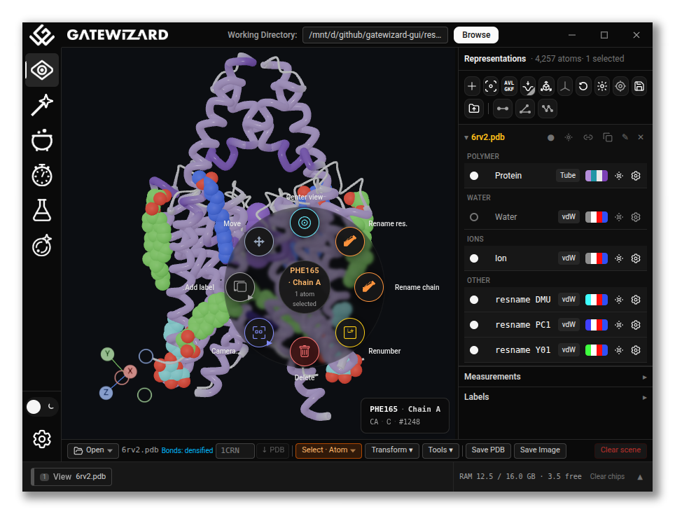

# GateWizard GUI


Desktop application for membrane protein preparation, system building, equilibration setup, and MD trajectory analysis

**This repository is the GUI only.** It is independent from the Python API and is distributed on its own.

The app uses the **[GateWizard API](https://github.com/maurobedoya/gatewizard)** under the hood. You do not need to clone the API repo to run the GUI, it installs `gatewizard` into its embedded Python environment. You can also use the API alone from Python or Jupyter without this app.

💬 **Questions and community help** → [gatewizard Discussions](https://github.com/maurobedoya/gatewizard/discussions) (shared forum for API and GUI; use labels `gui` or `gui:installation` for app topics)

**Manual (PDF):** [GateWizard-manual.pdf](https://github.com/maurobedoya/gatewizard/raw/main/docs/manual/GateWizard-manual.pdf) in the API repository. The cover lists the API and GUI versions.

[](./resources/readme/main_viewer.png)

<br clear="left" />

## Features

- **Visualize** — 3D representations with multi-structure workspace (append PDBs/CIFs; Maestro `.mae`/`.maegz` and multi-MODEL PDB entry picker), viewpoints/animation, Apply representation across structures, and multiple-bond sticks when bond orders are known. The sequence bar fills a short loop (1–6 residues). The structure checker compares alternate conformations, including a ligand. Minimize relaxes the current selection and writes a new PDB.
- **Preparation** — clean structures, pKa (PROPKA), protonation, termini capping, short-loop filling, and the higher-occupancy alternate conformation
- **Membrane builder** — orient protein, pack lipids and solvent, Amber parametrization (tleap). GateWizard supports **4028 lipid types** from packmol-memgen `--available_lipids_all` (version 2025.1.29), each with its residue name, charge, and chemical name. The catalog lists 4055 names; the 27 SIRAH lipids are coarse-grained and are not supported. See the [API builder reference](https://maurobedoya.github.io/gatewizard/api/builder/).
- **Equilibration** — the same CHARMM-GUI-style protocols for four MD engines: NAMD, GROMACS, OpenMM, and Amber (NVT, NPT, NPAT, NPγT)
- **Analysis** — trajectory metrics, structural analysis, and plotting helpers
- **Force fields** — Amber protein models (e.g. ff14SB, ff19SB) and common water/lipid setups
- **Cross-platform** — Linux (including WSL on Windows) and macOS installers

## Cluster profiles (remote equilibration)

GateWizard connects to Slurm clusters over SSH for **Connect & probe**, **Run on cluster**, and remote job progress. Configure profiles under **Settings** (gear icon) → **Cluster profiles**.

Passwords are never saved in the profile — they are session-only. If you set an **SSH identity file** (private key), GateWizard can log in without asking every time.

### What you need from your cluster

Ask your HPC support or check your cluster docs for:

| GateWizard field | Example | You replace with |
|------------------|---------|------------------|
| **Host** | `login.hpc.university.edu` | Your cluster’s SSH hostname |
| **Port** | `22` | Usually `22` (only change if your site says otherwise) |
| **Username** | `jsmith` | Your cluster login name (often your university ID) |
| **SSH identity file** | `~/.ssh/id_ed25519` | Path to your private key (see below) |

### Generate an SSH identity file

An SSH identity file is your **private key** — a small file on your laptop that proves who you are. You create it once, copy the matching **public** key to the cluster, then point GateWizard at the private key path.

Run these commands on the **same machine where GateWizard runs** (if you use WSL, open a WSL terminal — not Windows PowerShell).

**Step 1 — Create a key pair**

```bash
ssh-keygen -t ed25519 -f ~/.ssh/id_ed25519
```

When prompted:

- **Passphrase** — optional. Press Enter for none, or type a password to protect the key. GateWizard can still use a passphrase if `ssh-agent` has the key loaded.
- **File location** — the `-f ~/.ssh/id_ed25519` line already picks the default path. Just press Enter if `ssh-keygen` asks again.

This creates two files:

| File | Purpose |
|------|---------|
| `~/.ssh/id_ed25519` | **Private key** — keep secret; this is what you type in GateWizard’s **SSH identity file** |
| `~/.ssh/id_ed25519.pub` | **Public key** — safe to copy to the cluster |

The optional `-C "some label"` flag on `ssh-keygen` is only a comment inside the key (for your notes). You do **not** need to change `gatewizard` or anything else unless you want a custom label.

**RSA (only if your cluster does not accept Ed25519):**

```bash
ssh-keygen -t rsa -b 4096 -f ~/.ssh/id_rsa
```

Use `~/.ssh/id_rsa` as the identity file in GateWizard instead.

**Step 2 — Copy the public key to the cluster**

Replace `YOUR_USERNAME` and `YOUR_CLUSTER_HOST` with the same values you use in the cluster profile:

```bash
ssh-copy-id -i ~/.ssh/id_ed25519.pub YOUR_USERNAME@YOUR_CLUSTER_HOST
```

Example (username `jsmith`, host `login.hpc.university.edu`):

```bash
ssh-copy-id -i ~/.ssh/id_ed25519.pub jsmith@login.hpc.university.edu
```

If `ssh-copy-id` is not available, paste the **one line** from `~/.ssh/id_ed25519.pub` into `~/.ssh/authorized_keys` on the cluster.

**Step 3 — Set permissions (Linux / WSL / macOS)**

```bash
chmod 700 ~/.ssh
chmod 600 ~/.ssh/id_ed25519
```

**Step 4 — Test login**

```bash
ssh -i ~/.ssh/id_ed25519 YOUR_USERNAME@YOUR_CLUSTER_HOST
```

If that opens a shell on the cluster without errors, use this in GateWizard:

- **SSH identity file:** `~/.ssh/id_ed25519` (or `~/.ssh/id_rsa` if you used RSA)

## Install

Download the installer for your platform from [Releases](https://github.com/franciscoadasme/gatewizard-gui/releases).

**First launch** downloads Python packages in the background (several minutes). Keep the splash screen open — progress is shown there.

Install logs:
- **Linux / WSL:** `~/.config/gatewizard-gui/runtime-install.log`
- **macOS:** `~/Library/gatewizard-gui/runtime-install.log`

### Windows (via WSL)

Native Windows installers are **not published**. On a Windows PC, install **WSL 2** and use the **Linux** build (full MD workflow: AmberTools, membrane builder, OpenMM).

**Supported distros (tested):**

| Environment | Ubuntu / Debian / Fedora | Notes |
|-------------|-----------------|-------|
| **WSL** | **24.04** | Recommended. Tested with WSLg |
| WSL | 26.04 | Tested. The app selects Mesa d3d12 when `/dev/dxg` and `libd3d12.so` are present |
| WSL | 22.04 | Not supported. The `.deb` and the launcher refuse this distro |
| **Native Linux** | 22.04 or newer | Full support on a desktop with X11 or Wayland |

Use **WSL 2** with **WSLg** (`wsl --version` lists WSLg). WSL Ubuntu 24.04 and WSL Ubuntu 26.04 both run the packaged app. If the window reports `Maximum number of clients reached`, the Windows display is full. From Windows PowerShell run `wsl.exe --shutdown`, open one Ubuntu, and start `gatewizard-gui-linux` once.

**Uninstall.** `sudo apt remove gatewizard-gui-linux` removes the app and leaves the embedded Python environment on disk. That environment is `~/.config/gatewizard-gui/mamba-env` (micromamba, often several GB), next to the install log in the same folder. `sudo apt purge gatewizard-gui-linux` deletes `~/.config/gatewizard-gui` for the user who ran `sudo`, including `mamba-env`. The next launch builds it again. Purge does not delete a separate conda env such as `~/miniconda3/envs/gatewizard`, and it does not uninstall ALSA, GTK, or the other system libraries.

**`.deb` (Ubuntu/Debian/WSL):**
```bash
sudo apt install ./gatewizard-gui-*-linux-amd64.deb
gatewizard-gui-linux
```

The installer checks Electron’s system libraries (including ALSA, `libasound.so.2`) and a C compiler (`cc`) before it unpacks. Chromium links those libraries even though GateWizard does not play sound, and the first launch compiles one Python package. If anything is missing, the install stops and the console prints `sudo apt update` plus one `apt install` line. Run those commands, then install the `.deb` again. A fresh Ubuntu 26.04 list is often stale; that `sudo apt update` is what avoids **404 Not Found** while downloading `alsa-ucm-conf` and similar packages. The same check runs when you start `gatewizard-gui-linux`, so a missing compiler is reported before the long Python install.

**AppImage:**
```bash
chmod +x gatewizard-gui-*-linux-x86_64.AppImage
./gatewizard-gui-*-linux-x86_64.AppImage
```

AppImage does not install `.deb` dependencies. On a fresh Ubuntu / WSL box, install ALSA first if the launcher reports `libasound.so.2`:

```bash
sudo apt update
sudo apt install libasound2t64 || sudo apt install libasound2
```

If any other `.so` is missing, `gatewizard-gui-linux` (and the AppImage) print the `apt` / `dnf` command and exit instead of a raw loader error.

**Fedora Linux:**

Install FUSE and ALSA, then run the AppImage:

```bash
sudo dnf install -y fuse fuse-libs alsa-lib
chmod +x gatewizard-gui-*-linux-x86_64.AppImage
./gatewizard-gui-*-linux-x86_64.AppImage
```

On first launch, the app creates its internal Python environment and may download about 1 GB of packages. Keep the splash screen open until setup finishes.

Install log:

```bash
~/.config/gatewizard-gui/runtime-install.log
```

#### Display GPU (splash and Visualize)

This is the Electron / WebGL path, not OpenMM or GROMACS compute. There is no native Windows app — on Windows, use WSL.

| Runtime | What the app does |
|---------|-------------------|
| WSL with `/dev/dxg` and `/usr/lib/wsl/lib/libd3d12.so` | Sets `GALLIUM_DRIVER=d3d12` before Chromium starts (fixes Ubuntu 26.04 Mesa defaulting to llvmpipe). Mesa picks the adapter — the app does **not** hardcode NVIDIA. |
| WSL without those files | Leaves Mesa (often software GL; 3D is slower). |
| Native Linux | Unchanged (Mesa or the NVIDIA driver). |
| macOS | Unchanged (Metal). |

If Chromium’s GPU process crashes after the Python environment is ready, that session relaunches once in software mode (SwiftShader). A crash during the first install does not quit the app, so the install can finish. The next launch tries the GPU again. A `gpu-policy.json` left by an older build is deleted on startup.

Overrides (always win):

| Variable | Effect |
|----------|--------|
| `GATEWIZARD_GPU_SAFE_MODE=1` | SwiftShader software rendering |
| `GATEWIZARD_GALLIUM_DRIVER=llvmpipe` | Force Mesa software GL (empty value disables auto d3d12) |
| `GALLIUM_DRIVER` | Left as-is if already set |
| `MESA_D3D12_DEFAULT_ADAPTER_NAME=NVIDIA` | Optional, if Mesa picked the wrong GPU on a hybrid laptop |
| `GATEWIZARD_MAX_OLD_SPACE_SIZE` | Renderer V8 heap limit in **MB** (default **4096**, clamp 2048–16384) |

#### Renderer out-of-memory (large Maestro / multi-structure scenes)

If the console shows `JavaScript heap out of memory` / `renderer process gone` while loading many CTs, raise the heap before launching (value is megabytes; `8192` = 8 GB):

```bash
# WSL (one session)
GATEWIZARD_MAX_OLD_SPACE_SIZE=8192 npm run dev
```

To keep it across sessions, add `export GATEWIZARD_MAX_OLD_SPACE_SIZE=8192` to your WSL shell profile. Restart the app after changing it.

WSL often has no session D-Bus. The app reuses one `gatewizard-bus` socket instead of starting a new daemon on every launch. An older package can leave many `dbus-daemon` processes behind; stop them with `pkill -f gatewizard-bus || true`, then run `wsl.exe --shutdown` from Windows PowerShell.

If the splash screen appears but the main window never opens on WSL, force software rendering:

```bash
GATEWIZARD_GPU_SAFE_MODE=1 gatewizard-gui-linux --ozone-platform=wayland
```

The `gatewizard` PyPI package is the **Python API library** only (no console command). This app is launched as `gatewizard-gui-linux` or `gatewizard-gui-mac`.

Use the same `.deb` or AppImage steps above on **native Linux** desktops (Ubuntu 22.04+).

### macOS

GateWizard releases from GitHub are **not Apple-notarized** yet. macOS may block the app the first time — that is normal for unsigned downloads.

#### Install

1. Download the `.dmg` for your Mac from [Releases](https://github.com/franciscoadasme/gatewizard-gui/releases) (Apple Silicon: `*-mac-arm64.dmg`).
2. **Double-click** the `.dmg` to open it.
3. **Drag** `gatewizard-gui-mac.app` into **Applications**.
4. **Eject** the disk image.
5. Open **Applications** and launch **gatewizard-gui-mac** (do not run the app from inside the `.dmg`).

#### If macOS says it cannot verify the app

You may see a dialog like *“Apple could not verify that gatewizard-gui-mac is free of malware”*.

**Recommended (works on most Macs):**

1. Try to open the app once (it will be blocked).
2. Open **System Settings → Privacy & Security**.
3. Scroll down and click **Open Anyway** next to the GateWizard message.
4. Confirm **Open** in the next dialog.
5. Launch the app again from **Applications**.

**Alternatives:**

- **Right-click** `gatewizard-gui-mac.app` → **Open** → **Open** (first launch only).
- Terminal (removes the “downloaded from internet” quarantine flag):
  ```bash
  xattr -cr /Applications/gatewizard-gui-mac.app
  ```

Do **not** click **Move to Trash** in the Gatekeeper dialog — that deletes the app.

#### First launch

Wait on the splash screen until the main window appears (first run often **5–15 minutes** while Python packages install). Progress text appears below the logo.

Update the API later from the left sidebar: open **Settings** (gear), then **Versions & updates** → **Check for updates**.

#### Troubleshooting: `pip upgrade (tools) failed` / SSL not available

If the log shows **`SSL module is not available`** or **`libcrypto.3.dylib (not a mach-o file)`**, the embedded Python environment under `~/Library/gatewizard-gui/mamba-env` is **corrupted** — this is **not** a Homebrew issue. GateWizard uses its own conda Python, separate from anything you installed elsewhere.

**Fix (recommended):**

1. Quit GateWizard completely.
2. In Terminal:
   ```bash
   rm -rf ~/Library/gatewizard-gui/mamba-env
   rm -f ~/Library/gatewizard-gui/runtime-state.json
   ```
3. Relaunch **gatewizard-gui-mac** from **Applications** and wait for the splash screen to finish (the runtime reinstalls from scratch).

**If it happens again:** exclude `~/Library/gatewizard-gui` from **iCloud Desktop & Documents** sync — iCloud can corrupt binary libraries inside `mamba-env`.

**Verify after reinstall:**

```bash
~/Library/gatewizard-gui/mamba-env/bin/python -c "import ssl; print(ssl.OPENSSL_VERSION)"
```

You should see a line starting with `OpenSSL` (not an `ImportError`).

Newer app versions detect broken SSL on launch and remove the corrupted environment automatically before reinstalling.

## Dependencies

GateWizard is split across two repositories ([API](https://github.com/maurobedoya/gatewizard) + this GUI). Below is the **full dependency stack**; subsections mark what **this repo** installs automatically.

### Python — core (`pip install gatewizard`) · *[gatewizard](https://github.com/maurobedoya/gatewizard)*

| Package | Role |
|---------|------|
| Python ≥ 3.8 | Runtime |
| NumPy | Numerical arrays |
| Matplotlib | Plots and analysis figures |
| MDAnalysis | Trajectories and topologies |
| lipyphilic | Membrane / lipid analysis |
| PROPKA | pKa and protonation |
| RDKit | Ligand 2D structures |
| Pillow | Image I/O |
| psique | Structure / sequence tools |
| gemmi | mmCIF and biological assembly |
| freud-analysis | Voronoi area-per-lipid (EVAPL, GridMAT, VTMC) |
| requests | HTTP helpers |

### Python — optional `[full]` · *API; installed via embedded runtime*

| Package | Role |
|---------|------|
| ParmEd | Topology conversion (GROMACS, etc.) |
| OpenMM | Equilibration / MD (Python; use with conda `cudatoolkit` for GPU) |
| PDBFixer | Short loops of 1–6 residues |
| MemPrO | Membrane orientation ([GitHub](https://github.com/pstansfeld/MemPrO)) |

### Python — GUI backend · *this repo (embedded runtime)*

| Package | Role |
|---------|------|
| Python 3.12 | Embedded micromamba env |
| FastAPI | Local HTTP API |
| Uvicorn | ASGI server |
| Paramiko | SSH for Run on cluster |
| Biopython | Residue mutation |
| SciPy | Numerical helpers |
| Biotite | Chain superposition |
| PDBFixer | Short loops (also in `gatewizard[full]`) |
| gatewizard[full] | GateWizard API (pip, from `backend/requirements.txt`) |

### Conda (embedded runtime · automatic on first start)

| Package | Linux / WSL | macOS | Native Windows |
|---------|-------------|-------|----------------|
| AmberTools 26 | yes | yes | no — use WSL |
| reduce (bioconda) | yes | yes | no — use WSL |
| OpenMM (conda) | yes | yes | no |
| cudatoolkit (OpenMM CUDA) | yes | no (Metal) | no |
| GROMACS (CPU) | yes | yes | no — use WSL |

After `pip install gatewizard[full]`, the app re-syncs conda OpenMM packages on Linux/WSL so GPU support is kept.

Same packages are in the API [`environment.yml`](https://github.com/maurobedoya/gatewizard/blob/main/environment.yml) for conda-based API installs.

### Desktop app · *this repo (`npm install` / installer)*

| Package | Role |
|---------|------|
| Electron | Desktop shell |
| Node.js 20+ | App and build runtime |
| Svelte 5 | UI framework |
| Vite | Frontend bundler |
| Tailwind CSS | Styling |
| Three.js + Threlte | 3D structure viewer |
| electron-updater | In-app update checks |

### External MD engines (install separately · neither repo)

| Tool | Role |
|------|------|
| [NAMD](https://www.ks.uiuc.edu/Research/namd/) | Run NAMD equilibration — `namd3` / `namd2` on `PATH` |
| [GROMACS](https://www.gromacs.org/) | Run GROMACS equilibration — `gmx` on `PATH` |
| [Amber](https://ambermd.org/) | Run Amber equilibration — `pmemd` / `pmemd.cuda`, or `sander` from AmberTools |

OpenMM needs no separate binary — provided by `gatewizard[full]` + conda above. Check platforms on **Equilibration → OpenMM** after install.

### Provided by this repository

| Component | Included |
|-----------|----------|
| Desktop app (Electron, Svelte, Three.js viewer) | yes |
| Embedded Python + FastAPI backend | yes |
| `gatewizard[full]` (pip) | yes — on first start / API update |
| AmberTools, OpenMM, cudatoolkit (conda) | Linux/WSL/macOS only |
| NAMD, GROMACS, and Amber `pmemd` binaries | no — user install (`sander` comes with AmberTools) |
| Standalone API package source | no — [gatewizard](https://github.com/maurobedoya/gatewizard) |

### Platform notes

| Platform | Full workflow (builder, equilibration) |
|----------|----------------------------------------|
| Linux / WSL | Yes |
| macOS | Yes, where AmberTools is available |
| Native Windows | Not supported — use WSL with the Linux build |

### Python API (optional)

If you prefer scripts or notebooks without the desktop app: **[github.com/maurobedoya/gatewizard](https://github.com/maurobedoya/gatewizard)**

```bash
pip install gatewizard
```

## Development

Requirements: **Node.js 20+**, **npm**, on **WSL** (not Windows PowerShell). For the full MD workflow, AmberTools and related tools live in the WSL conda env `gatewizard`.

Python, pytest, and `backend/` use that env:

```bash
conda activate gatewizard
cd backend && python -m pytest
```

From Windows PowerShell, call the same interpreter through WSL (`~/miniconda3/envs/gatewizard/bin/python`). Do not use Windows `python` or `%APPDATA%\gatewizard-gui\mamba-env`.

```bash
git clone https://github.com/maurobedoya/gatewizard-gui.git
cd gatewizard-gui
npm install
npm run dev
```

`npm run dev` applies the same display-GPU policy as the packaged app (WSL d3d12 when GPU files exist). `npm run dev:wsl` is an explicit **software-only** hammer (`LIBGL_ALWAYS_SOFTWARE` + SwiftShader) — use it only to debug a broken GPU stack, not as the default:

```bash
npm run dev:wsl
```

Install `npm` dependencies in **WSL only**, not from Windows on the same folder.

### Build installers

| Platform | Command | Release artifact (example) |
|----------|---------|----------------------------|
| Linux / WSL | `npm run build:linux` | `gatewizard-gui-1.0.11-linux-x86_64.AppImage`, `.deb` |
| macOS | `npm run build:mac` (on macOS) | `gatewizard-gui-1.0.11-mac-arm64.dmg` |

CI publishes **Linux and macOS only**. A native Windows `.exe` can be built locally (`npm run build:win:pack`) but is not shipped on GitHub Releases.

## Community and support

| Need | Where |
|------|--------|
| Questions, workflows, install help | [Discussions](https://github.com/maurobedoya/gatewizard/discussions) on the API repo (label `gui` or `gui:installation`) |
| GUI bug or feature | [Issues](https://github.com/franciscoadasme/gatewizard-gui/issues/new/choose) in this repo |
| API bug or feature | [Issues](https://github.com/maurobedoya/gatewizard/issues/new/choose) in gatewizard |
| API docs and troubleshooting | [Documentation](https://maurobedoya.github.io/gatewizard/) |

New to the project? Read the [welcome post](https://github.com/maurobedoya/gatewizard/discussions/36).

## License

GateWizard GUI is licensed under the [MIT License](LICENSE).

Copyright (c) 2025-2026 Constanza González, Francisco Adasme, Mauricio González, Janin Riedelsberger, and Mauricio Bedoya
